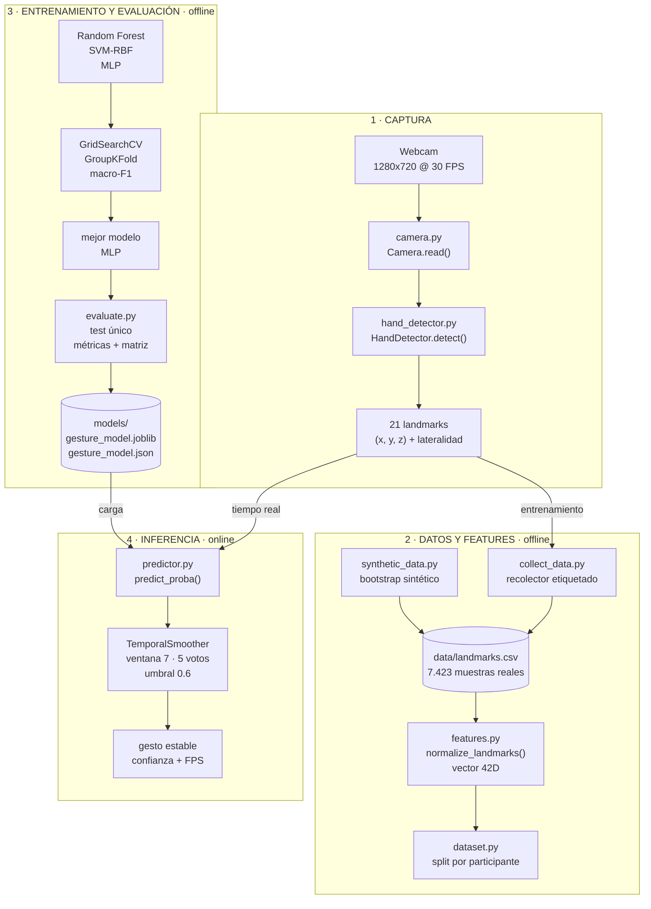

# Gesture Rush — Diagrama de flujo actual

> **Estado:** Fases 1–4 implementadas. Este diagrama muestra **solo lo que existe y se ejecuta hoy**: captura, dataset, features, entrenamiento/evaluación e inferencia.
>
> No incluye las fases 5–8 (jugadores, rondas, UI y pruebas con tres personas) porque todavía no están implementadas.

---

## 1. Diagrama



**Cómo se lee:** la banda 1 produce los 21 landmarks. Esa misma captura alimenta dos caminos:

- **Offline (bandas 2–3):** los landmarks se guardan, se normalizan, se dividen por participante, se entrenan los tres modelos y se guarda el mejor.
- **Online (banda 4):** los landmarks en vivo pasan por el modelo guardado y por el suavizado temporal hasta obtener un gesto estable.

---

## 2. Etapas, módulos y funciones

### Banda 1 · Captura

| Etapa | Módulo | Funciones clave | Qué hace | Salida |
|---|---|---|---|---|
| Cámara | `camera.py` | `Camera.open()`, `read()`, `fps` | Abre la webcam, prueba backends y reconecta si falla un frame | Frame BGR |
| Detección | `hand_detector.py` | `HandDetector.detect()`, `HandResult`, `draw_hand()`, `ensure_model()` | Ejecuta MediaPipe Hand Landmarker y extrae 21 puntos por mano | `landmarks (21,3)` + `handedness` |

### Banda 2 · Datos y features

| Etapa | Módulo | Funciones clave | Qué hace | Salida |
|---|---|---|---|---|
| Recolección | `collect_data.py` | `DataCollector.add()`, `_is_duplicate()`, `counts()`, `save()` | Captura muestras etiquetadas, descarta duplicados y controla el balance | CSV acumulativo |
| Bootstrap | `synthetic_data.py` | `generate()`, `make_sample()`, `canonical_template()` | Genera landmarks sintéticos para probar la tubería sin webcam | CSV de arranque |
| Features | `features.py` | `normalize_landmarks()`, `feature_spec()`, `validate_landmarks()` | Traslada la muñeca al origen, escala por la palma y aplana | Vector de 42 dimensiones |
| División | `dataset.py` | `load_dataset()`, `validate_dataset()`, `featurize()`, `group_split()` | Valida el CSV y separa train/val/test por participante | `X`, `y`, índices |

### Banda 3 · Entrenamiento y evaluación

| Etapa | Módulo | Funciones clave | Qué hace | Salida |
|---|---|---|---|---|
| Modelos | `train.py` | `build_models()` | Define Random Forest, SVM-RBF y MLP con sus grillas | Tres candidatos |
| Ajuste | `train.py` | `_fit_best()`, `_make_cv()` | Busca hiperparámetros con `GridSearchCV` y `GroupKFold` | Mejor variante por modelo |
| Selección | `train.py` | `train_and_select()` | Compara por macro-F1 en validación, reajusta y evalúa una vez en test | Modelo ganador |
| Evaluación | `evaluate.py` | `compute_metrics()`, `confusion_matrix()`, `measure_inference_time()`, `top_confusions()` | Calcula accuracy, precision/recall/F1, matriz y latencia | Métricas y gráficos |
| Persistencia | `train.py` | `joblib.dump`, JSON de metadatos | Guarda modelo, clases, features, split y métricas | `.joblib` + `.json` |

### Banda 4 · Inferencia

| Etapa | Módulo | Funciones clave | Qué hace | Salida |
|---|---|---|---|---|
| Predicción | `predictor.py` | `Predictor.load()`, `predict_proba()`, `predict()` | Carga el modelo, valida features y devuelve etiqueta + confianza | Etiqueta por frame |
| Estabilización | `predictor.py` | `TemporalSmoother.update()`, `reset()` | Exige 5 votos iguales en 7 frames y confianza ≥ 0.6 | Gesto estable o `__no_hand__` |

---

## 3. Decisiones que hay detrás

- **MediaPipe no clasifica gestos.** Solo detecta la mano y devuelve 21 landmarks; los gestos los decide un modelo entrenado en el proyecto.
- **Una sola normalización.** `dataset.featurize()` y `Predictor.predict_proba()` usan la misma `normalize_landmarks()`; la especificación se guarda en el JSON y se valida al cargar.
- **Features invariantes a posición y escala.** Se resta la muñeca y se divide por el tamaño de la palma; la orientación se conserva a propósito.
- **División agrupada por participante.** Ninguna persona aparece en train y test a la vez; el test se evalúa una sola vez.
- **Selección por macro-F1.** Evita que una clase mayoritaria oculte el mal rendimiento en las demás.
- **Suavizado temporal.** Una predicción aislada no alcanza: se necesitan 5 votos en 7 frames y confianza ≥ 0.6.
- **Ausencia de mano = estado explícito.** `NO_HAND` no es una clase inventada por el clasificador.

---

## 4. Estado actual medido

> Estas cifras corresponden a la campaña anterior, de 5 clases, archivada en
> `data/legacy/`, `models/legacy/` y `reports/legacy/`. La campaña actual de 10
> clases no tiene todavía dataset ni modelo entrenado.

| Dato | Valor |
|---|---|
| Dataset | 7.423 muestras reales · 4 participantes · 3 sesiones |
| Clases | 5: `open_palm`, `fist`, `thumbs_up`, `victory`, `pointing_index` |
| Vocabulario actual del código | 10: las 5 anteriores + `ok_sign`, `rock`, `shaka`, `pinky_up`, `l_shape` |
| Modelo desplegado | MLP `(64, 32)`, `alpha=0.01` (campaña anterior) |
| Test reservado | accuracy **0.6845** · F1 macro **0.6746** · F1 ponderado **0.6803** |
| Inferencia | **0.0009 ms/muestra** (solo el clasificador) |
| Validación cruzada LOPO | accuracy **0.7628 ± 0.0576** · F1 macro **0.7613 ± 0.0607** |
| Mejor clase | `open_palm`, F1 0.873 ± 0.070 |
| Clase más débil | `fist`, F1 0.616 ± 0.134 |
| Confusión principal | `fist → pointing_index` (256 casos) |

> La brecha entre validación (F1 0.828) y test (F1 0.675) indica que el modelo todavía no generaliza igual a una persona no vista. La meta de F1 macro > 0.90 no está alcanzada.

---

## 5. Prompt para generar la imagen

```text
Crear una infografía técnica horizontal 16:9, estilo diagrama de flujo profesional,
fondo blanco hueso (#F7F9FC), tipografía sans-serif geométrica, paleta limitada:
azul marino (#12355B), turquesa (#1B998B), ámbar (#F4A261), verde suave (#2A9D8F),
gris (#6B7280). Líneas finas, flechas claras, iconos planos y minimalistas.
Sin texto inventado: usar exactamente las etiquetas indicadas.

Título: "GESTURE RUSH — Pipeline del reconocedor de gestos".
Subtítulo: "Fases 1–4 implementadas · 5 gestos · 7.423 muestras reales · 4 participantes".

Organizar en 4 bandas horizontales numeradas, de arriba hacia abajo:

BANDA 1 — "1 · CAPTURA" (turquesa)
Cuatro cajas en fila, de izquierda a derecha:
"Webcam 1280x720 @ 30 FPS" → "camera.py · Camera.read()" →
"hand_detector.py · HandDetector.detect()" → "21 landmarks (x, y, z) + lateralidad".
Iconos: cámara, engranaje, mano con 21 puntos.

BANDA 2 — "2 · DATOS Y FEATURES · offline" (azul)
Cajas en fila:
"collect_data.py · recolector etiquetado" → "data/landmarks.csv · 7.423 muestras reales"
→ "features.py · normalize_landmarks() · vector 42D" → "dataset.py · split por participante".
Debajo de "collect_data.py", una caja secundaria:
"synthetic_data.py · bootstrap sintético", con flecha hacia el CSV.
Iconos: CSV/base de datos, regla, tijeras o división.

BANDA 3 — "3 · ENTRENAMIENTO Y EVALUACIÓN · offline" (ámbar)
Cajas en fila:
"Random Forest · SVM-RBF · MLP" → "GridSearchCV · GroupKFold · macro-F1" →
"mejor modelo · MLP" → "evaluate.py · test único · métricas + matriz" →
"models/ · gesture_model.joblib · gesture_model.json".
Iconos: tres modelos, rejilla de búsqueda, trofeo, matriz de confusión.

BANDA 4 — "4 · INFERENCIA · online" (verde)
Cajas en fila:
"predictor.py · predict_proba()" → "TemporalSmoother · ventana 7 · 5 votos · umbral 0.6"
→ "gesto estable · confianza + FPS".
Icono: monitor o cámara en vivo.

FLECHAS ENTRE BANDAS
- Desde "21 landmarks" bajar una flecha etiquetada "entrenamiento" hacia "collect_data.py".
- Desde "21 landmarks" bajar otra flecha etiquetada "tiempo real" hacia "predictor.py".
- Desde "models/ · gesture_model.joblib" bajar una flecha etiquetada "carga" hacia "predictor.py".

Añadir una nota pequeña al pie:
"MediaPipe detecta la mano; la clasificación de los 5 gestos es un modelo propio entrenado y evaluado en el proyecto."

Evitar: fases 5–8, bloques de jugadores, rondas, UI, texto largo, 3D, sombras excesivas, estilo cartoon.
Priorizar: orden vertical claro, bandas alineadas, flechas inequívocas, mucho aire.
```

### Versión corta

```text
Infografía técnica 16:9, flat, fondo blanco hueso, paleta azul marino/turquesa/ámbar/verde.
Título: "GESTURE RUSH — Pipeline del reconocedor de gestos".
4 bandas horizontales:
1) CAPTURA: Webcam → camera.py → hand_detector.py (MediaPipe) → 21 landmarks.
2) DATOS Y FEATURES: collect_data.py → landmarks.csv → features.py (42D) → split por participante.
3) ENTRENAMIENTO: Random Forest / SVM-RBF / MLP → GridSearchCV macro-F1 → mejor modelo (MLP) → evaluate.py → joblib + json.
4) INFERENCIA: predictor.py → TemporalSmoother (7/5/0.6) → gesto estable + FPS.
Flechas: landmarks → entrenamiento, landmarks → inferencia, modelo → inferencia.
Sin fases 5–8. Iconos planos, texto mínimo y legible.
```

---

## 6. Cómo reutilizar el diagrama

1. **Mermaid Live Editor** (`https://mermaid.live`): pegar el bloque de la sección 1 y exportar SVG/PNG.
2. **draw.io / diagrams.net**: importar `docs/gesture_rush_pipeline.mmd`.
3. **Generador de imágenes**: usar el prompt de la sección 5.
